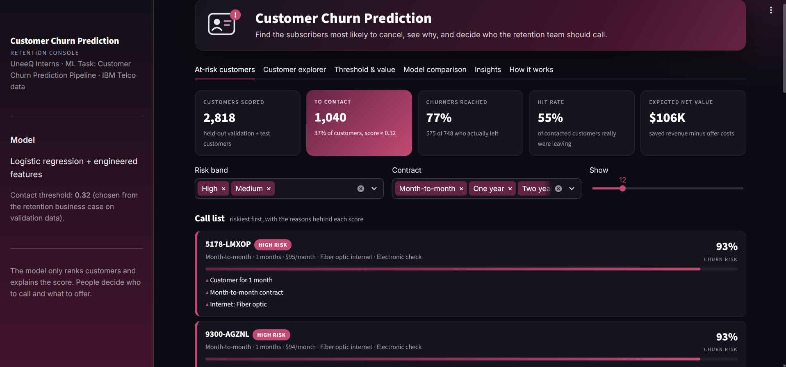
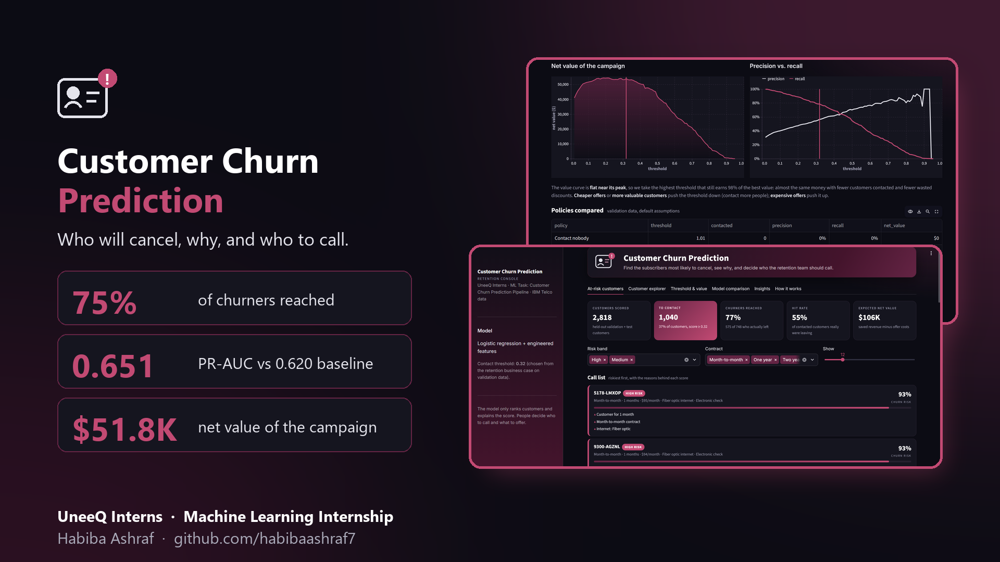
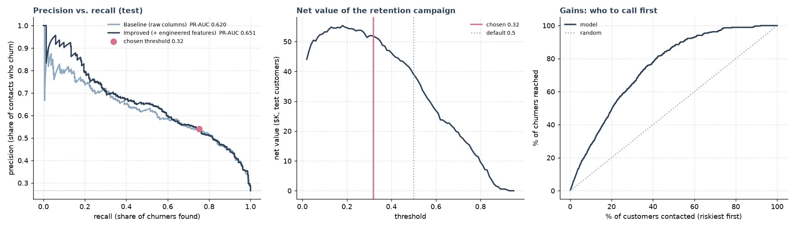
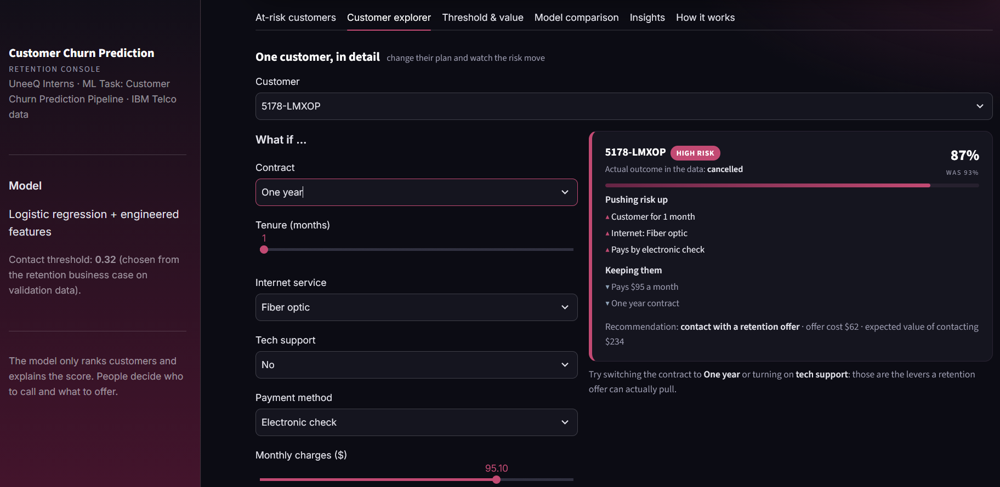
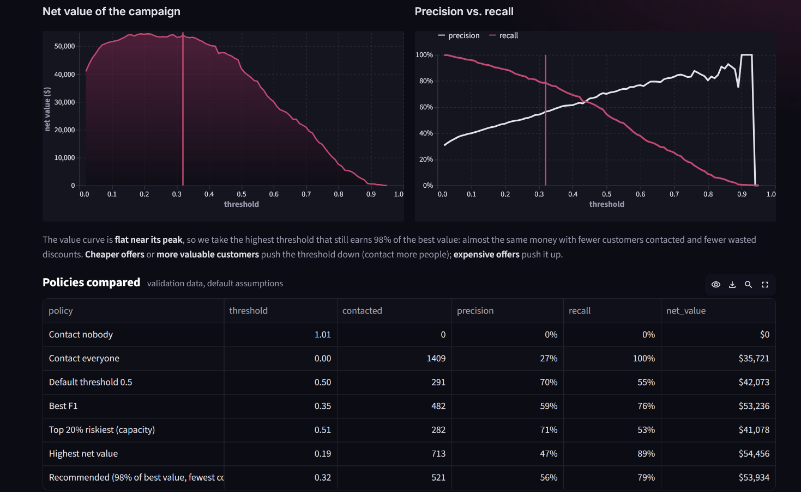
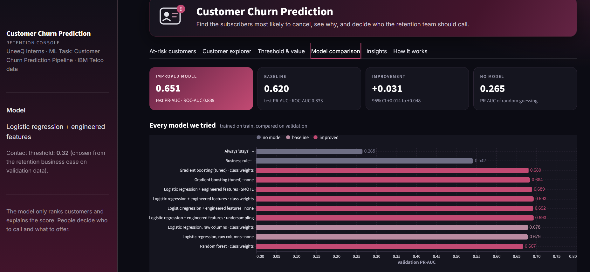
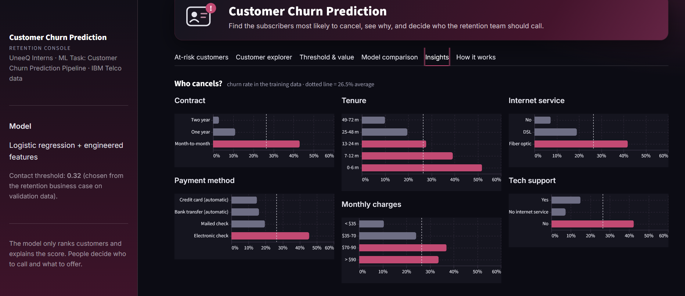

# Customer Churn Prediction

A churn prediction pipeline for a subscription company. It finds the customers most likely to cancel, explains why, and recommends who the retention team should contact, based on what an offer costs and what a saved customer is worth. Built for the UneeQ Interns machine learning internship.



## Demo

[](demo/churn_demo.mp4)

A 90-second silent walkthrough with captions: [demo/churn_demo.mp4](demo/churn_demo.mp4). Click it, then "View raw" to play.

## Data

[IBM Telco Customer Churn](https://github.com/IBM/telco-customer-churn-on-icp4d): 7,043 customers of a phone and internet provider.
* **Columns:** services, contract, billing, payment method and tenure.
* **Churn:** 26.5% of customers cancelled.
* **Download:** the pipeline fetches the data automatically.

## Approach

1. **EDA and cleaning.**
   * Fixed the blank charges of 11 brand-new customers.
   * Added five simple features: number of services, auto-pay, current bill vs. average bill, new customer, and log tenure.
2. **Split.** 60/20/20, stratified. Every choice was made on validation data, and the test set was used once.
3. **Models.**
   * **Baseline:** logistic regression on the raw columns.
   * **Improved:** the same model with the engineered features.
   * **Also tried:** random forest and tuned gradient boosting.
4. **Class imbalance.** I compared no handling, class weights, SMOTE and undersampling.
5. **Threshold.** Chosen from a retention business case instead of the default 0.5.
6. **Explanations.** The top 3 reasons for every customer, the main drivers overall, and a fairness check.
7. **Serving.** A Streamlit retention console and a FastAPI endpoint.

## Results (test set)

| Model | PR-AUC | ROC-AUC |
|---|---|---|
| Always "stays" | 0.265 | 0.50 |
| Baseline logistic regression | 0.620 | 0.833 |
| **Improved logistic regression** | **0.651** | **0.839** |

- **The engineered features gave a real improvement:** +0.031 PR-AUC, 95% bootstrap interval +0.014 to +0.048.
- **Bigger models (random forest, gradient boosting) didn't beat it** on this small, mostly categorical dataset.
- **Class weights, SMOTE and undersampling all gave the same ranking** (PR-AUC 0.689–0.693 on validation). They only shift the scores, so I handled the imbalance through the threshold.

### Choosing the threshold

Assumptions:
- Contacting a customer costs $5.
- The offer is 20% off for 3 months.
- It keeps 30% of real churners.
- A saved customer is worth 12 more months of their bill.

| Policy | Contacted | Precision | Recall | Net value |
|---|---|---|---|---|
| Contact everyone | 100% | 27% | 100% | $39.8K |
| Default threshold 0.5 | 21% | 65% | 51% | $39.0K |
| **Recommended threshold 0.32** | **37%** | **54%** | **75%** | **$51.8K** |

- **Why 0.32?** The value curve is flat near the top, so I picked the highest threshold that still earns 98% of the best value. That means nearly the same money while contacting 27% fewer customers.
- **The right threshold depends on the business numbers.** Cheaper offers push it down and expensive ones push it up. The app recalculates it live.



### What drives churn

**Tenure, contract type and internet service** matter most. The riskiest customers are:
- new (first months);
- on month-to-month contracts;
- on fiber optic;
- without tech support;
- paying by electronic check.

Gender isn't used by the model, and it reaches 75% of churners for both women and men.

### How the business should use it

- **Every month,** export the call list (riskiest first) and give it to the retention team.
- **Match the offer to the reason:**
  - month-to-month → discount for a 1-year contract;
  - no tech support → free trial;
  - electronic check → auto-pay incentive.
- **Keep a small control group without offers,** to measure the real save rate.
- **Retrain every quarter.**

Full details are in the [model report](reports/model_report.md) and the [notebook](notebooks/churn_pipeline.ipynb).

## Run it

Python 3.10+.

```bash
git clone https://github.com/habibaashraf7/customer_churn-prediction-pipeline.git
cd customer_churn-prediction-pipeline
pip install -r requirements.txt
python -m src.pipeline      # download -> EDA -> train -> threshold -> evaluate (~40 s)
streamlit run app.py        # retention console
uvicorn api:app --reload    # REST API, docs at http://127.0.0.1:8000/docs
```

The pipeline uses fixed seeds, so a rerun gives the same numbers.

The app has six views:
1. **At-risk customers:** the call list with risk scores and reasons, plus a CSV download.
2. **Customer explorer:** change a customer's contract or services and watch their risk move.
3. **Threshold & value:** enter your own costs and get the best threshold live.
4. **Model comparison:** every model tried, precision-recall curves and the confusion matrix.
5. **Insights:** who cancels, what drives the model, and the fairness check.
6. **How it works**

| Customer explorer | Threshold & value |
|---|---|
|  |  |
| **Model comparison** | **Insights** |
|  |  |

**API example**

```bash
curl -X POST http://127.0.0.1:8000/predict -H "Content-Type: application/json" \
     -d '{"tenure": 3, "Contract": "Month-to-month", "InternetService": "Fiber optic", "MonthlyCharges": 85}'
```

It returns the churn probability, the risk band, whether to contact the customer, and the top reasons.

## Project structure

```
app.py               Streamlit retention console
api.py               FastAPI endpoint
src/pipeline.py      runs every step below in order
src/data.py          download, cleaning, features, split
src/eda.py           churn-rate charts
src/train.py         baseline vs. improved models, imbalance strategies
src/threshold.py     business-value threshold and sensitivity analysis
src/evaluate.py      test results, fairness, figures
src/explain.py       per-customer reasons
src/service.py       small Python API used by the app and the API
notebooks/           walkthrough notebook
reports/             model report, results, figures
```

## Resources

| Resource | Used for |
|---|---|
| [IBM Telco Customer Churn](https://github.com/IBM/telco-customer-churn-on-icp4d) (also on [Kaggle](https://www.kaggle.com/datasets/blastchar/telco-customer-churn)) | the data: 7,043 customers, 21 columns |
| [scikit-learn](https://scikit-learn.org/) | logistic regression, random forest, gradient boosting, metrics |
| [imbalanced-learn](https://imbalanced-learn.org/) | SMOTE and random undersampling |
| [Streamlit](https://streamlit.io/), [Altair](https://altair-viz.github.io/) and [FastAPI](https://fastapi.tiangolo.com/) | the retention console, its charts and the REST API |
| [Chawla et al. (2002), SMOTE: Synthetic Minority Over-sampling Technique](https://doi.org/10.1613/jair.953) | the SMOTE comparison |
| [Lundberg & Lee (2017), A Unified Approach to Interpreting Model Predictions](https://arxiv.org/abs/1705.07874) | SHAP; for a linear model the contributions are exact |

## Limitations

- **The data is a single snapshot with no dates,** so the split is random rather than time-based.
- **The business numbers (save rate, offer cost) are assumptions** until they're measured.
- **The reasons show association, not cause.**
- **There's no usage or complaint data,** which would probably help a lot.
