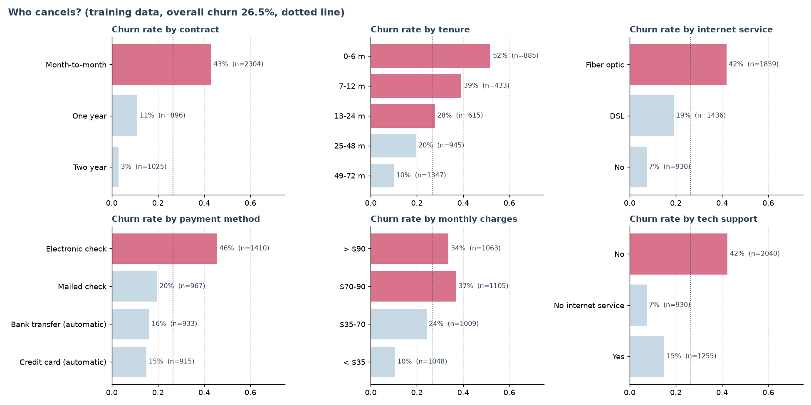
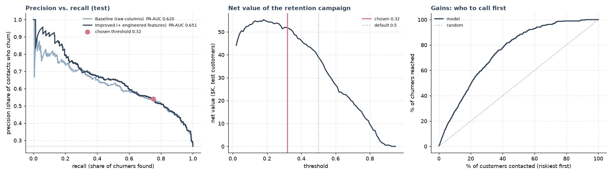
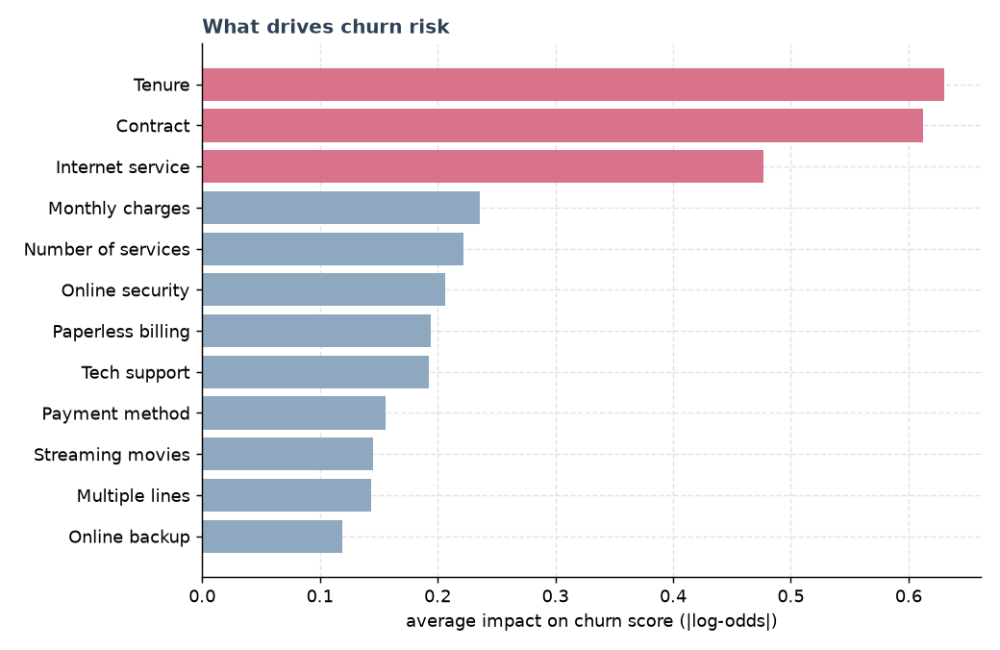

# Model Report: Customer Churn Prediction

**Task:** UneeQ Interns · Machine Learning track · *ML Task: Customer Churn Prediction Pipeline*

**Goal:** a subscription company wants to find customers at risk of cancelling, and to know how to act on it. Build a churn model, and explain how the business should use it.

**Data:** [IBM Telco Customer Churn](https://github.com/IBM/telco-customer-churn-on-icp4d): 7,043 customers of a phone and internet subscription company, with 21 columns (services, contract, billing, tenure). 26.5% of the customers churned.

---

## 1. Summary

| Requirement | Result |
|---|---|
| **EDA and preprocessing** | Churn rates by contract, tenure, service and payment. Blank charges fixed; 5 engineered features. Section 2 |
| **Baseline and improved model** | Baseline: logistic regression on the raw columns. **Test PR-AUC 0.620**. Improved: + engineered features. **Test PR-AUC 0.651** (+0.031, 95% CI +0.014 to +0.048) |
| **Class imbalance** | Compared none, class weights, SMOTE and undersampling. They give the same ranking (PR-AUC 0.689–0.693), so the imbalance is handled where it matters: the decision threshold |
| **Precision/recall and threshold** | Threshold **0.32**, chosen from a retention business case. On test: 75% of churners reached, 54% precision, **$51.8K net value** (vs $39.0K with the default 0.5) |
| **Explainability** | Global drivers plus the top 3 reasons for every customer. Fairness check by gender, age and household |
| **Reproducible** | `python -m src.pipeline` reruns everything in about 40 seconds and gives identical numbers (fixed seeds) |

## 2. Data and preprocessing

**Cleaning**
* `TotalCharges` is blank for 11 customers with tenure 0. They haven't been billed yet, so it's set to 0.
* There are no duplicate customers and no other missing values.

**Engineered features.** Each one is simple and uses only information the company already has:

| Feature | Meaning |
|---|---|
| `n_services` | number of services the customer uses (phone, internet, security, backup…) |
| `auto_pay` | pays by automatic bank transfer or card |
| `charge_vs_avg` | current bill ÷ average bill so far (above 1 = the price went up) |
| `new_customer` | tenure of 6 months or less |
| `log_tenure` | log of tenure: churn risk falls fastest in the first months |

**Split:** 60% train (4,225), 20% validation (1,409), 20% test (1,409), stratified so each part has 26.5% churn.
* The data is a single snapshot with no dates, so a time-based split isn't possible.
* Every choice (model, threshold) was made on train and validation. The test set was used once.

**Gender** is not used as a model input. It is only used afterwards, to check fairness.

### What the EDA shows (training data)



| Group | Churn rate |
|---|---|
| Month-to-month contract | **43%** (one year: 11%, two years: 3%) |
| First 6 months | **52%** (after 4 years: 10%) |
| Fiber optic internet | **42%** (DSL: 19%, no internet: 7%) |
| Pays by electronic check | **46%** (automatic payment: 15–16%) |
| No tech support | **42%** (with tech support: 15%) |

Churners are new (median tenure 10 months vs 38) and pay more ($80 a month vs $64).

## 3. Models

All candidates were trained on train, scored with 5-fold cross-validation on train, and checked on validation.

**Why PR-AUC?** Only 26.5% of customers churn. Accuracy rewards doing nothing (73.5% for "nobody churns"). PR-AUC measures how clean the top of the risk list is, and the retention team works from the top.

| Model | Imbalance handling | CV PR-AUC | Validation PR-AUC | Validation ROC-AUC |
|---|---|---|---|---|
| Always "stays" | – | – | 0.265 | 0.500 |
| Business rule (month-to-month + first year + fiber) | – | – | 0.542 | 0.809 |
| **Baseline:** logistic regression, raw columns | none | 0.664 | 0.679 | 0.860 |
| Baseline | class weights | 0.660 | 0.678 | 0.860 |
| **Improved:** logistic regression + engineered features | **none** | **0.674** | **0.692** | **0.864** |
| Improved | class weights | 0.673 | 0.693 | 0.863 |
| Improved | SMOTE | 0.670 | 0.689 | 0.860 |
| Improved | undersampling | 0.669 | 0.693 | 0.862 |
| Random forest | class weights | 0.663 | 0.667 | 0.855 |
| Gradient boosting (tuned) | none | 0.668 | 0.684 | 0.859 |
| Gradient boosting (tuned) | class weights | 0.669 | 0.680 | 0.857 |

**Findings**
* **Feature engineering helped more than a bigger model.** Random forest and tuned gradient boosting did not beat logistic regression. The data is small (7K rows) and mostly categorical, and the main effects are close to linear in log-odds.
* **Imbalance handling changed the scores, not the ranking.** Class weights, SMOTE and undersampling all land within 0.004 PR-AUC of each other. What they change is the default 0.5 cut-off, for example recall at 0.5 rises from 55% to 82%. That's a threshold decision, so it's made explicitly in section 4.
* **The chosen model is the improved logistic regression without resampling.** It's best on CV, it's the simplest, and its probabilities are well calibrated (checked below).

**Test set (used once)**

| | Baseline | Improved |
|---|---|---|
| PR-AUC | 0.620 | **0.651** |
| ROC-AUC | 0.833 | **0.839** |

The paired bootstrap difference is +0.031 (95% CI +0.014 to +0.048), so the improvement is real.

**Calibration (test).** The scores can be read as probabilities. Split into five equal groups by score:

| Predicted churn | 2% | 7% | 19% | 40% | 67% |
|---|---|---|---|---|---|
| **Actual churn** | 1% | 8% | 20% | 38% | 65% |

That's what makes the expected-value maths in the next section trustworthy.

## 4. Threshold selection (the business case)

Everyone above the threshold gets a retention offer. The threshold is chosen by **money**, not by 0.5 or F1.

| Assumption | Default (editable in the app) |
|---|---|
| Contacting a customer | $5 of agent time |
| Retention offer | 20% off the bill for 3 months, given to everyone contacted (that's the cost of a false alarm) |
| Offer success | keeps 30% of real churners |
| Value of a saved customer | 12 more months of their bill |

**Net value = (saved churners × their value) − (contact + discount for everyone contacted).**

**Choosing the threshold (validation).** The net-value curve is flat near its peak: anything from 0.15 to 0.35 earns within about 3% of the best. So we take the **highest threshold that keeps at least 98% of the best value**. That's **0.32**, and it contacts 27% fewer customers than the peak (0.19) for 1% less value. A smaller campaign means fewer discounts given to loyal customers who weren't leaving, and less work for the team.

**Results on test:**

| Policy | Threshold | Contacted | Precision | Recall | Net value |
|---|---|---|---|---|---|
| Contact nobody | – | 0 | – | 0% | $0 |
| Contact everyone | 0.00 | 1,409 | 27% | 100% | $39.8K |
| Default threshold | 0.50 | 295 | 65% | 51% | $39.0K |
| Top 20% riskiest (fixed capacity) | 0.52 | 282 | 65% | 49% | $37.4K |
| Best F1 | 0.31 | 528 | 54% | 76% | $52.0K |
| Highest net value | 0.18 | 719 | 46% | 89% | $55.4K |
| **Recommended** | **0.32** | **519** | **54%** | **75%** | **$51.8K** |



**Gains:** calling the riskiest 10% of customers reaches 28% of all churners, the top 20% reaches 49%, and the top 30% reaches 65%.

**Sensitivity: the threshold follows the economics.** Recommended threshold for different assumptions (validation):

| Save rate / value months | Discount 10% | Discount 20% | Discount 30% |
|---|---|---|---|
| 15% / 12 months | 0.36 | 0.49 | 0.49 |
| **30% / 12 months** | 0.20 | **0.32** | 0.38 |
| 30% / 24 months | 0.11 | 0.19 | 0.22 |
| 50% / 12 months | 0.15 | 0.21 | 0.23 |

* **Cheap offers or valuable customers →** a lower threshold (contact more people).
* **Expensive offers or a weak save rate →** a higher one.

The threshold is a business setting, not a model setting, and the app's *Threshold & value* tab recalculates it live.

## 5. Explainability

Because the model is a logistic regression, each customer's score splits exactly into per-feature contributions (this is linear SHAP): coefficient × (value − average). One-hot columns are summed back to the original column.



**Top drivers (test set, mean impact):**
1. tenure;
2. contract;
3. internet service;
4. monthly charges;
5. number of services;
6. online security, paperless billing, tech support and payment method.

**Example reasons for the riskiest test customers:**

| Customer | Risk | Top reasons |
|---|---|---|
| 9300-AGZNL | 93% | Customer for 1 month · Month-to-month contract · Internet: fiber optic |
| 0295-PPHDO | 92% | Customer for 1 month · Month-to-month contract · Internet: fiber optic |

**Note:** with contract, services and fiber already in the model, *monthly charges* has a small protective effect. Among customers on the same plan, paying more means having more add-ons, and those customers are stickier. The contributions show **association, not cause**: raising someone's bill won't keep them.

## 6. Fairness check (test, threshold 0.32)

| Group | Churn rate | Flagged | Recall | Precision |
|---|---|---|---|---|
| Female | 29% | 39% | 75% | 56% |
| Male | 24% | 34% | 75% | 53% |
| Not senior | 23% | 31% | 71% | 53% |
| Senior | 43% | 65% | 85% | 56% |

* **Gender is not a model input, and recall is equal for women and men.**
* **Seniors are flagged more often because they churn more (43%)**, and precision is the same across groups.

## 7. How the business should use it

1. **Every month,** score all customers and export the call list, riskiest first, from the app.
2. **Tailor the offer to the reason:**
   * month-to-month → discount for moving to a 1-year contract;
   * no tech support or security → free trial;
   * electronic check → incentive to switch to auto-pay.
3. **Contact everyone above the threshold**, or the top N if the team has a fixed capacity. The gains curve shows what each extra call is worth.
4. **Keep a random control group** (for example 10% of flagged customers get no offer), so the real save rate can replace the 30% assumption.
5. **Retrain every quarter**, recompute the threshold when offer costs change, and re-check the fairness table.

## 8. Limitations

| Limitation | Effect / next step |
|---|---|
| **Single snapshot, no dates** | Random split instead of time-based. A real deployment should train on past months and test on the next month |
| **Business numbers are assumptions** | The threshold moves with them. Measure the real save rate and offer cost with a control group |
| **Associations, not causes** | The reasons show what goes with churn, not what will stop it. An A/B test of offers is needed for that |
| **Small dataset (7K)** | ±0.02 noise on PR-AUC; bootstrap intervals are reported |
| **No usage data** | Complaints, support calls and usage drops would likely improve the model a lot |

## 9. Reproduce

```bash
pip install -r requirements.txt
python -m src.pipeline      # data -> EDA -> train -> threshold -> evaluate (~40 s)
streamlit run app.py        # retention console
uvicorn api:app --reload    # REST API, docs at http://127.0.0.1:8000/docs
```
